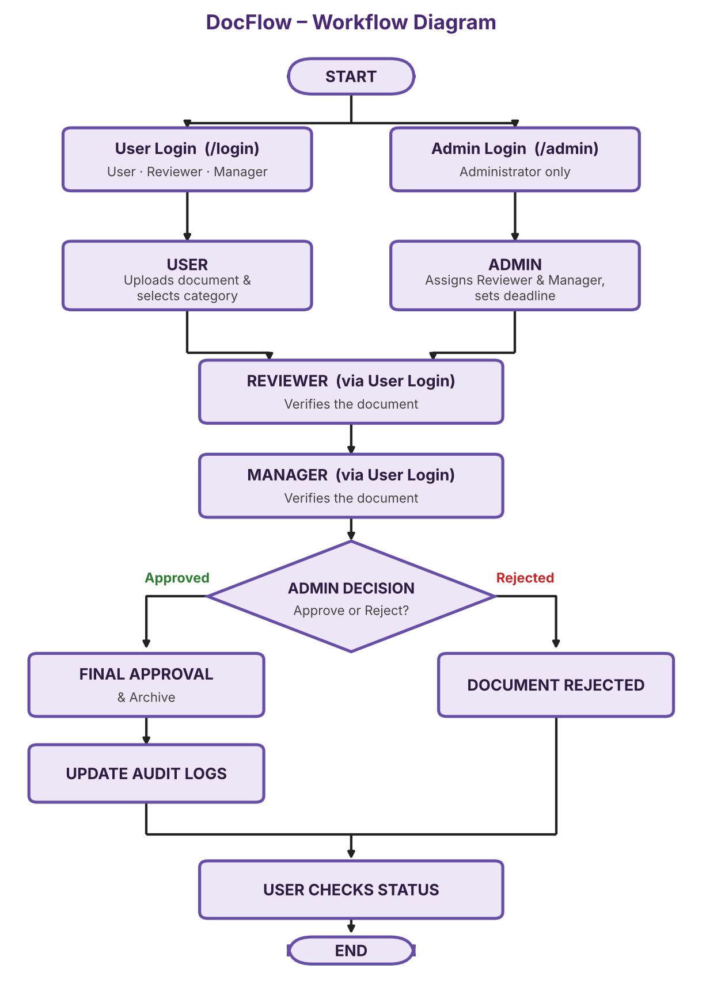

# Digital Document Approval and Workflow Platform

## 1. Project Overview

The **Digital Document Approval and Workflow Platform (DocFlow)** is a web-based application developed to simplify and manage the document approval process in an organisation.

The system provides a centralized platform where users can log in, upload documents, select a document category, and track the approval status of their documents.

Administrators can assign a reviewer and a manager to each document, set a deadline, and take the final decision after both verifications are completed.

Reviewers and managers log in through the same user login and verify the documents assigned to them, while the administrator has a separate login.

Approved documents are archived automatically, and every important action is recorded in audit logs.

The main objective is to improve transparency, reduce manual paperwork, and make document approval faster and more accountable.

## 2. Features

The Digital Document Approval and Workflow Platform provides role-based functionalities for users, reviewers, managers and administrators to make document approval simple, secure and traceable.

### 2.1 User Module

- **User Login:** Secure login through `/login`.
- **Upload Document:** Upload a document and select its category.
- **Track Document Status:** Check whether a document is under review, approved or rejected.
- **View Final Result:** See the final decision after the administrator completes the approval.
- **Deadline Visibility:** View the deadline set by the administrator for each document.
- **Own Documents Only:** Each user can see only the documents uploaded by them.
- **Document Preview:** Open and view the uploaded file from the status page.

### 2.2 Reviewer Module

- **Reviewer Login:** Log in through the same user login (`/login`).
- **View Assigned Documents:** See the documents assigned by the administrator.
- **Document Verification:** Verify the document and submit remarks.
- **View Uploaded File:** Open and read the document before verifying it.
- **Deadline Tracking:** See the deadline set by the administrator for each assigned document.
- **Verification History:** View the documents already verified by the reviewer.

### 2.3 Manager Module

- **Manager Login:** Log in through the same user login (`/login`).
- **View Assigned Documents:** See the documents that have completed reviewer verification.
- **Document Verification:** Verify the document and submit remarks.
- **View Reviewer Remarks:** Read the reviewer's remarks before giving verification.
- **View Uploaded File:** Open and read the document before verifying it.
- **Verification History:** View the documents already verified by the manager.

### 2.4 Admin Module

- **Admin Login:** Separate and secure login through `/admin`.
- **Dashboard:** View statistics on documents, pending reviews, approvals and rejections.
- **Assign Reviewer and Manager:** Assign both to a document and set a deadline.
- **Final Decision:** Approve or reject the document after both verifications.
- **Archive:** Archive approved documents.
- **Audit Logs:** Monitor all actions performed in the system.
- **User Management:** View the registered users, reviewers and managers.
- **Document Monitoring:** Track the current stage of every document in the workflow.
- **Deadline Monitoring:** Identify documents that are close to or past their deadline.

### 2.5 General Features

- Role-based access for User, Reviewer, Manager and Admin.
- MySQL database integration for data management.
- Secure password hashing using Werkzeug.
- Supporting document upload and management.
- Document status tracking.
- Audit logging of every important action.
- Session-based login with secure logout.
- Unique file names for uploaded documents to avoid conflicts.
- Responsive interface built with Bootstrap 5.

### Overall Outcome

The platform removes manual paperwork and delays, and gives every role a clear responsibility in the approval process.

## 3. Technology Stack

| Category           | Technologies                              |
|--------------------|-------------------------------------------|
| Frontend           | HTML, CSS, Bootstrap 5                    |
| Backend            | Python, Flask                             |
| Database           | MySQL                                     |
| Database Connector | mysql-connector-python                    |
| Authentication     | Flask Sessions, Werkzeug Password Hashing |
| Email Service      | Python Email / SMTP                       |
| Development Tools  | Visual Studio Code, Git, GitHub           |

## 4. Project Workflow

The platform follows a fixed sequence: upload, assignment, reviewer verification, manager verification and the administrator's final decision.
Reviewers and managers sign in through the same user login (`/login`), while the administrator signs in separately (`/admin`).

### Workflow Diagram

| Workflow Diagram |
| :---: |
|  |

### Workflow Description

1. **Login**
   - **User, Reviewer and Manager:** log in at `/login`.
   - **Admin:** logs in separately at `/admin`.
2. **User**
   - Uploads a document and selects its category.
   - Later checks the document status (Under Review, Approved or Rejected).
3. **Admin – Assignment**
   - Assigns one Reviewer and one Manager to the uploaded document.
   - Sets the deadline for the verification.
4. **Reviewer** (logs in through the user login)
   - Opens the documents assigned to them.
   - Verifies the document and submits remarks.
5. **Manager** (logs in through the user login)
   - Receives the document after the Reviewer's verification.
   - Verifies the document and submits remarks.
6. **Admin – Final Decision**
   - Checks both verifications.
   - Approves or rejects the document.
7. **Completion**
   - **Approved:** the document gets final approval and is archived, and the audit logs are updated.
   - **Rejected:** the document is marked as rejected.
   - In both cases the User checks the final status.

## 5. Project Setup and Installation

### Prerequisites

- Python 3.10 or above
- MySQL Server
- Git
- Visual Studio Code (recommended)

### Step 1: Clone the Repository

```
git clone <your-repository-url>
```

### Step 2: Navigate to the Project Directory

```
cd docflow
```

### Step 3: Create a Virtual Environment

```
python -m venv venv
```

### Step 4: Activate the Virtual Environment

For Windows:

```
venv\Scripts\activate
```

For macOS / Linux:

```
source venv/bin/activate
```

### Step 5: Install Dependencies

```
pip install -r requirements.txt
```

### Step 6: Configure the Database

1. Start your MySQL Server.
2. Create a database named `docflow`.
3. Import the provided `database.sql` file.
4. Configure the database connection details in the `.env` file.

### Step 7: Run the Application

```
python app.py
```

Open your browser and visit:

```
http://127.0.0.1:5000/
```

## 6. Environment Variables

Create a `.env` file in the project root directory and configure the following variables:

```
DB_HOST=localhost
DB_PORT=3306
DB_USER=root
DB_PASSWORD=your_mysql_password
DB_NAME=docflow

SECRET_KEY=your_secret_key

MAIL_USERNAME=your_email@gmail.com
MAIL_PASSWORD=your_email_app_password
```

**Note:** Replace the example values with your actual configuration. Never upload your `.env` file or expose database credentials and email passwords on GitHub.

## 7. API and Database Notes

### Database

The application uses MySQL to store and manage user, document, assignment, verification, archive and audit log information.

Major database tables include:

- `users` – Stores user, reviewer and manager login details and roles.
- `admins` – Stores administrator login details.
- `categories` – Stores document categories.
- `documents` – Stores uploaded document references, category, status and archive flag.
- `assignments` – Stores the assigned reviewer, manager and deadline for each document.
- `verifications` – Stores reviewer and manager verification results and remarks.
- `audit_logs` – Stores every action with the actor and timestamp.

### Application Processing

- Flask routes handle user, reviewer, manager and admin requests.
- MySQL queries perform database operations.
- Document status changes step by step: `Uploaded → Assigned → Under Review → Under Manager Review → Approved / Rejected`.
- Approved documents are archived after the administrator's decision.
- Audit log entries are created after each important action.

The application primarily uses Flask server-side routes and does not depend on a separate REST API service.

## 8. Team Member Contributions

### Individual Project Development

**Team Member:** Maheswari

This project was independently developed by Maheswari, who handled the complete development process, from requirement analysis to implementation and testing.

### Key Responsibilities

- **Requirement Analysis:** Identified project requirements and planned the user, reviewer, manager and admin workflows.
- **Frontend Development:** Designed responsive user interfaces using HTML, CSS and Bootstrap 5.
- **Backend Development:** Implemented application functionality using Python and Flask, including authentication, document upload and status tracking.
- **Database Integration:** Designed and managed the MySQL database and integrated it with Flask using `mysql-connector-python`.
- **Workflow Management:** Developed reviewer and manager verification, admin assignment with deadline, and the final approval or rejection.
- **Archiving and Audit Logs:** Implemented archiving of approved documents and audit log recording.
- **Security:** Implemented password hashing, role-based access and session management.
- **Testing and Documentation:** Tested application workflows, fixed errors, maintained the GitHub repository, and prepared project documentation.

### Development Outcome

Successfully developed a web-based platform that simplifies document upload, multi-stage verification, final approval and status tracking.

# Application Code Documentation

This section explains the Python modules, Flask functions, route functions, helper functions and application execution used in the `app.py` file of the Digital Document Approval and Workflow Platform.

## 1. Python Imports and Their Uses

| Module / Import          | Purpose                                                                    |
|--------------------------|----------------------------------------------------------------------------|
| `Flask`                  | Creates the Flask web application.                                         |
| `render_template`        | Displays HTML pages from the templates folder.                             |
| `request`                | Retrieves data submitted through HTML forms.                               |
| `redirect`               | Redirects users from one route to another.                                 |
| `url_for`                | Generates URLs using Flask route function names.                           |
| `flash`                  | Displays success, error and warning messages.                              |
| `session`                | Stores login session information, such as user ID and role.                |
| `send_file`              | Sends uploaded documents to the browser for viewing or downloading.        |
| `abort`                  | Stops request processing and returns HTTP errors such as 403 or 404.       |
| `Path`                   | Handles file and folder paths.                                             |
| `uuid4`                  | Generates unique identifiers for uploaded document filenames.              |
| `secure_filename`        | Sanitizes uploaded filenames for safer file handling.                      |
| `generate_password_hash` | Converts plain-text passwords into secure hashes before storing them.      |
| `check_password_hash`    | Verifies submitted passwords against stored password hashes.               |
| `get_db_connection`      | Connects the Flask application to the MySQL database (from `database.py`). |
| `send_email`             | Sends email messages (from `mail.py`).                                     |
| `datetime`               | Records timestamps for actions and audit logs.                             |
| `date`                   | Handles dates, such as checking document deadlines.                        |

## 2. Functions in app.py and Their Uses

### 2.1 General and User Module Functions

| Function            | Route        | Description                                                                                         |
|---------------------|--------------|-----------------------------------------------------------------------------------------------------|
| `index()`           | `/`          | Redirects users to the login page when they open the application.                                   |
| `login()`           | `/login`     | Authenticates User, Reviewer and Manager accounts and redirects them according to their role.       |
| `dashboard()`       | `/dashboard` | Displays the user's dashboard with document counts and recent documents.                            |
| `upload_document()` | `/upload`    | Validates the file, saves it with a unique name, stores the category and creates the document record. |
| `check_status()`    | `/status`    | Displays the user's documents with their current status and final decision.                         |
| `logout()`          | `/logout`    | Clears the current session and redirects the user to the login page.                                |

### 2.2 Reviewer and Manager Module Functions

| Function               | Route                         | Description                                                                          |
|------------------------|-------------------------------|--------------------------------------------------------------------------------------|
| `reviewer_dashboard()` | `/reviewer`                   | Lists the documents assigned to the logged-in reviewer.                              |
| `reviewer_verify()`    | `/reviewer/verify/<doc_id>`   | Records the reviewer's verification and remarks and moves the document to the manager. |
| `manager_dashboard()`  | `/manager`                    | Lists the documents waiting for the logged-in manager.                               |
| `manager_verify()`     | `/manager/verify/<doc_id>`    | Records the manager's verification and remarks and sends the document to the admin.  |

### 2.3 Admin Module Functions

| Function             | Route                          | Description                                                                                  |
|----------------------|--------------------------------|----------------------------------------------------------------------------------------------|
| `admin_login()`      | `/admin`                       | Authenticates administrators and creates an admin session.                                   |
| `admin_dashboard()`  | `/admin/dashboard`             | Displays statistics such as total, pending, approved and rejected documents.                 |
| `assign_document()`  | `/admin/assign/<doc_id>`       | Assigns a reviewer and a manager to a document and sets the deadline.                        |
| `admin_decision()`   | `/admin/decision/<doc_id>`     | Shows both verifications and records the final approval or rejection.                        |
| `view_document()`    | `/view_document/<doc_id>`      | Allows authorised roles to view an uploaded document.                                        |
| `view_audit_logs()`  | `/admin/audit_logs`            | Displays all audit log entries.                                                              |

### 2.4 General and Helper Functions

| Function                    | Description                                                                              |
|-----------------------------|------------------------------------------------------------------------------------------|
| `role_required(role)`       | Decorator that allows a route only for the permitted role.                               |
| `allowed_file(filename)`    | Checks that the uploaded file type is permitted.                                         |
| `archive_document(doc_id)`  | Marks an approved document as archived.                                                  |
| `log_action(...)`           | Writes an entry (document, actor, action, time) to the `audit_logs` table.               |

> **Note:** Function and route names above are suggested. Replace them with the exact names used in your `app.py`.

## 3. Application Execution

| Code                                               | Purpose                                                          |
|----------------------------------------------------|------------------------------------------------------------------|
| `app = Flask(__name__)`                            | Creates the Flask application instance.                          |
| `app.secret_key = os.getenv("SECRET_KEY")`         | Configures the secret key used to sign session cookies.          |
| `UPLOAD_FOLDER.mkdir(parents=True, exist_ok=True)` | Creates the document upload folder if it does not already exist. |
| `if __name__ == '__main__':`                       | Checks whether the Python file is being executed directly.       |
| `app.run(debug=True)`                              | Starts the Flask development server with debug mode enabled.     |

**Note:** Debug mode should be disabled in production.

## 4. Summary

The `app.py` file acts as the main controller of the platform. It connects the frontend pages with backend functionality and the MySQL database.

It manages login for all four roles, document upload, assignment, reviewer and manager verification, the administrator's final decision, archiving and audit logging.

## 9. Application Executive Summary

The Digital Document Approval and Workflow Platform digitises the complete document approval cycle inside one secure web application.
It removes delays, lost files and unclear ownership by assigning clear roles, deadlines and a fixed verification order.
Users upload and track documents, Reviewers and Managers verify them, and the Admin controls assignments and final decisions.
Built with Python Flask and MySQL, the system keeps a full audit trail of every action.
The result is a faster, more transparent and more accountable approval process.

## 10. Future Scope

- Email and SMS notifications for assignments, deadlines and decisions.
- Multiple reviewers and multi-level approval chains.
- Digital signatures on approved documents.
- Automatic deadline reminders and escalation.
- Document version history.
- Search, filters and analytics dashboard.
- Cloud storage and cloud deployment.
- Mobile application support.

## 11. Conclusion

The Digital Document Approval and Workflow Platform provides an organized and transparent approach to managing document approvals. By separating responsibilities among User, Reviewer, Manager and Admin, and recording every action in audit logs, it reduces manual work, saves time and improves accountability. The planned enhancements can extend it into a complete enterprise document management solution.
